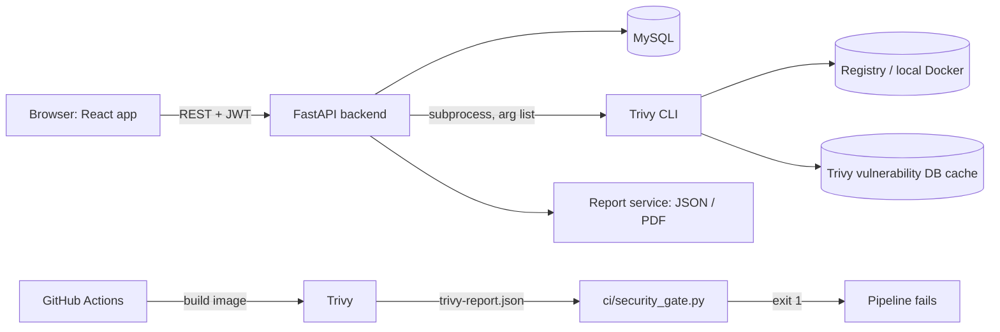

# SecureShip

**Secure every container before deployment.**

SecureShip is a container vulnerability scanning and security-automation platform. Developers submit a
Docker image, SecureShip scans it with the real [Trivy](https://trivy.dev) scanner, classifies the
findings, computes an explainable security score, checks the result against a deployment policy,
recommends fixes, and keeps a scan history with downloadable reports. A GitHub Actions workflow
enforces the same kind of gate in CI and fails the pipeline when a policy is violated.

## Problem statement

Container images routinely ship with known vulnerabilities inherited from base images and packages.
Teams often discover them only after deployment. Scanners exist, but their output is large and raw,
and nothing connects results to a team-specific "is this safe to ship?" decision. SecureShip closes
that gap: scan early, score and explain the result, apply a configurable policy, and block the
pipeline automatically.

## Objectives

1. Scan images with the actual Trivy CLI (no fabricated results).
2. Classify findings by severity and store them in MySQL.
3. Produce an explainable 0-100 security score.
4. Evaluate configurable security policies.
5. Recommend available fixes (upgrade package X to version Y).
6. Provide a lightweight dashboard, scan history and JSON/PDF reports.
7. Enforce thresholds in CI/CD with a gate that genuinely fails the pipeline.

## Technology stack

| Layer | Technology |
|---|---|
| Frontend | React, Vite, JavaScript, plain CSS, native Fetch (no router/UI/chart libraries) |
| Backend | Python, FastAPI, SQLAlchemy, Pydantic, Alembic |
| Database | MySQL 8 |
| Security | Docker, Trivy |
| Auth | JWT (python-jose) + bcrypt |
| CI/CD | GitHub Actions |
| Tests | Pytest, Vitest + React Testing Library |

## Architecture



```
 React (5173)  --HTTP/JSON-->  FastAPI (8000)  --SQLAlchemy-->  MySQL (3306)
                                    |
                                    +-- subprocess --> trivy image --format json <ref>
```

Request flow for a scan: validate input, check rate limit, claim a scan slot, run Trivy (argument
list, never `shell=True`), parse JSON, store findings, compute score, evaluate policy, return result.

## Features

- Real Trivy scanning with timeouts and clear errors (Trivy missing, Docker down, bad image,
  network failure, timeout, malformed output). Failed scans are saved with the reason.
- Severity classification and filtering (Critical/High/Medium/Low/Unknown).
- Explainable score with a per-severity breakdown shown in the UI ("How this score was calculated").
- Fix recommendations grouped per package using Trivy's fixed-version data.
- Dashboard: images scanned, total and critical vulnerabilities, average score, severity
  distribution, recent scans. All numbers come from `GET /api/scans/stats`.
- Scan history with reopenable results, JSON and PDF reports.
- Per-user configurable policy (limits plus block-or-warn per severity).
- CI security gate (`ci/security_gate.py`) that fails the workflow.

### Scoring (project-defined, not an industry standard)

```
total_risk = critical*10 + high*6 + medium*3 + low*1
score      = 100 * exp(-total_risk / 50)
```

| Score | Category |
|---|---|
| 90-100 | Excellent |
| 70-89 | Good |
| 40-69 | Needs Attention |
| 0-39 | Critical Risk |

The exponential normalisation keeps the score within 0-100: a clean image scores 100 and the score
falls smoothly as weighted risk grows (risk 50 gives about 37).

### Policy semantics

`max_critical` and `max_high` are limits. A `block_on_*` flag decides whether exceeding a limit fails
the policy (blocking) or only raises a warning. Defaults: 0 critical (blocking), 5 high (warning).

## Database schema

| Table | Key columns |
|---|---|
| `users` | id, username (unique), email (unique), hashed_password, is_active, timestamps |
| `docker_images` | id, user_id → users, image_name, image_tag, full_reference |
| `scan_results` | id, image_id → docker_images, user_id → users, status (pending/scanning/completed/failed), security_score, risk_category, total/critical/high/medium/low/unknown counts, trivy_output (JSON), error_message, started_at, completed_at |
| `vulnerabilities` | id, scan_id → scan_results, cve_id, package_name, installed_version, fixed_version, severity, title, description, references (JSON) |
| `security_policies` | id, user_id → users (unique), max_critical, max_high, block_on_critical, block_on_high |
| `reports` | id, scan_id → scan_results, user_id → users, report_type (json/pdf), file_path |

Indexes on user_id, image_id, scan_id and severity. Managed with Alembic (`backend/alembic/versions/001_initial.py`).

## API

Interactive docs at `/docs`. Everything except register/login requires `Authorization: Bearer <token>`,
and every scan/report/vulnerability lookup is restricted to the owning user (others get 404).

| Method | Path | Purpose |
|---|---|---|
| POST | `/api/auth/register`, `/api/auth/login` | Create account / log in |
| POST, GET | `/api/images` | Register / list images |
| POST | `/api/scans` | Run a scan (429 over the rate limit, 503 if the scanner is busy) |
| GET | `/api/scans` | List scans |
| GET | `/api/scans/stats` | Dashboard statistics |
| GET | `/api/scans/{id}` | Scan with policy result and score explanation |
| GET | `/api/scans/{id}/vulnerabilities?severity=CRITICAL` | Findings, most severe first |
| GET | `/api/scans/{id}/recommendations` | Upgrade advice |
| GET | `/api/reports/{id}/json`, `/pdf` | Download report (completed scans only) |
| GET, PUT | `/api/policies` | Read / update policy |
| GET | `/api/health` | Liveness |

## Installation

### 1. Trivy

- macOS: `brew install trivy`
- Debian/Ubuntu or any Linux: `curl -sfL https://raw.githubusercontent.com/aquasecurity/trivy/main/contrib/install.sh | sudo sh -s -- -b /usr/local/bin`
- Windows/other: see https://trivy.dev/latest/getting-started/installation/

Check with `trivy --version`. The Docker image for the backend already includes Trivy.

### 2. Docker Compose (recommended)

```bash
cp .env.example .env     # set JWT_SECRET to a random value
docker compose up --build
```

App: http://localhost:5173, API docs: http://localhost:8000/docs. Compose runs the frontend, backend
and MySQL with a health check and persistent volumes (database, Trivy cache, reports).

### 3. Local development

Needs Python 3.12+, Node 20+, MySQL 8, Trivy.

```bash
cd backend
python -m venv .venv && source .venv/bin/activate
pip install -r requirements.txt
export DATABASE_URL="mysql+pymysql://root:<password>@localhost:3306/secureship"
export JWT_SECRET="<random string>"
alembic upgrade head
uvicorn app.main:app --reload --port 8000

cd frontend && npm install && npm run dev
```

## Environment configuration

See `.env.example`. Never commit `.env`.

| Variable | Purpose | Default |
|---|---|---|
| `MYSQL_ROOT_PASSWORD`, `DATABASE_URL` | Database | see file |
| `JWT_SECRET`, `JWT_ALGORITHM`, `JWT_EXPIRATION_MINUTES` | Auth | HS256 / 1440 |
| `TRIVY_TIMEOUT` | Seconds before a scan is aborted | 300 |
| `SCAN_RATE_LIMIT_PER_HOUR` | Scans per user per hour | 20 |
| `MAX_CONCURRENT_SCANS` | Simultaneous scans per backend process | 2 |
| `MAX_REQUEST_BYTES` | Request body limit | 100000 |
| `CORS_ORIGINS` | Allowed browser origins | localhost:5173 |
| `VITE_API_URL` | API URL baked into the frontend build | http://localhost:8000/api |

The rate limit and concurrency cap are held in process memory, so they apply per backend process.

## GitHub Actions

`.github/workflows/security-scan.yml` has two jobs:

1. **tests**: backend pytest, frontend tests and build.
2. **container-scan**: build the backend image, install Trivy, scan to `trivy-report.json`, upload it as an
   artifact (always), then run `python3 ci/security_gate.py trivy-report.json`, which exits 1 on a violation.

Thresholds live in the workflow `env:` block: `MAX_CRITICAL`, `FAIL_ON_CRITICAL`, `MAX_HIGH`,
`FAIL_ON_HIGH`, `IGNORE_UNFIXED`. If the report is missing or unreadable the gate exits 2, so it fails
closed. To make the gate block merges, enable branch protection and require the `container-scan` check.

The gate is enforced by CI itself, not by any UI control. The gate script is tested by running it as
a subprocess and asserting its exit codes (`backend/tests/test_security_gate.py`).

## Security practices

Bcrypt password hashing; JWT auth on all data routes; ownership checks; strict image-name and tag
validation (first character must be alphanumeric so values cannot become CLI flags); Trivy invoked with
an argument list and never a shell; scan timeouts; per-user rate limit and concurrent-scan cap; request
size limit; security headers; generic 500 responses with no stack traces; no arbitrary Docker commands
exposed.

## Testing

```bash
cd backend && python -m pytest             # unit and API tests, Trivy mocked, in-memory SQLite
cd backend && python -m pytest -m integration -v   # runs the real Trivy binary (needs network)
cd frontend && npm test
```

Coverage includes auth, ownership, validation, parsing, scoring, policy evaluation, reports, clean /
critical / high-only images, invalid references, scanner failures, rate limits, and CI pass/fail.
The integration tests skip automatically when `trivy` is not installed.

## Screenshots

Screenshots are not bundled. After `docker compose up`, capture the Dashboard, Scan image,
Scan history and Security settings views into `docs/screenshots/` and link them here.

## Known limitations and future improvements

- Scans run inside the request; move them to a background worker with status polling.
- Rate limiting is in-memory per process; use Redis for multi-instance deployments.
- Mounting the Docker socket gives the backend container control of the host Docker; remove it if only
  registry images are scanned.
- Add SBOM export, scheduled re-scans, email/Slack alerts, role-based access, and secret/misconfiguration scanning.
